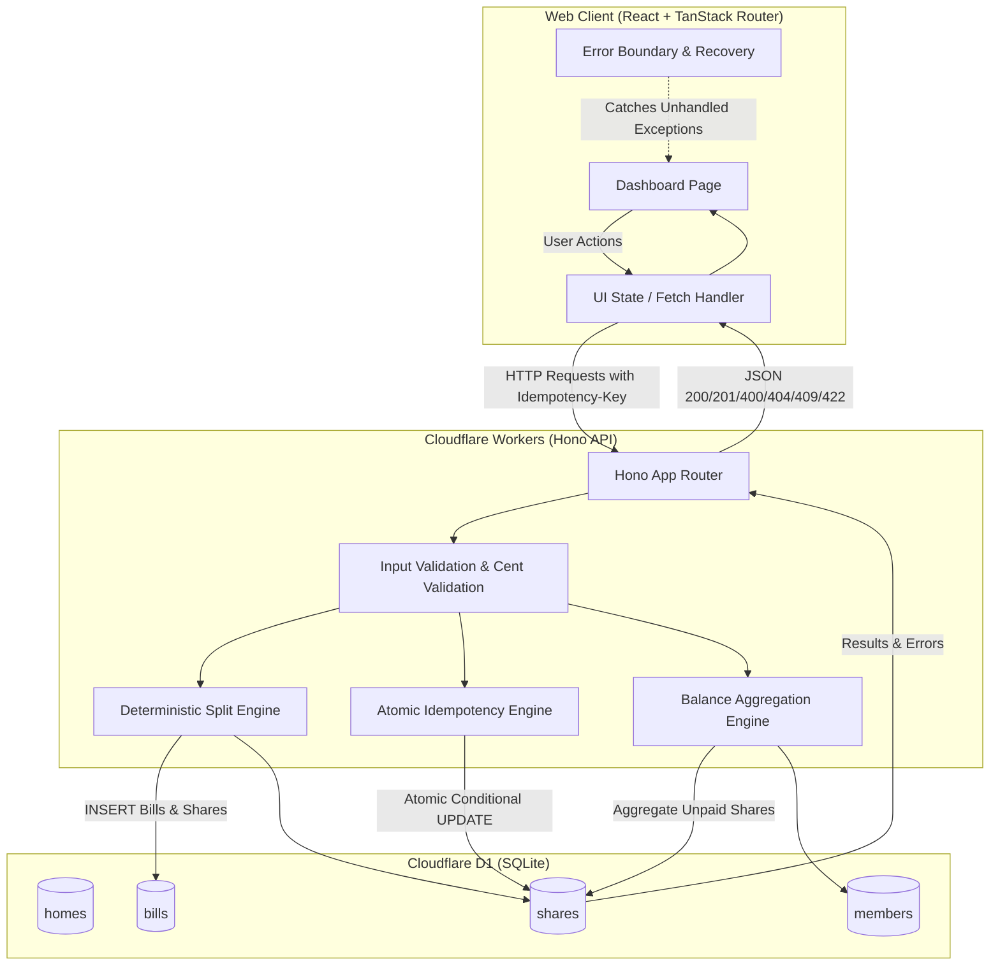

# Implementation Plan: Shared Bill Splitter (SDE Intern Task)

## Goal Description

Build a robust, type-safe, and concurrency-resilient shared bill splitting application with:

1. **Cloudflare D1 (SQLite) Schema & Migrations**: Relational schema protecting data integrity with at least 3 named constraints (foreign keys, check constraints, unique keys).
2. **Hono on Cloudflare Workers API**: Fully typed REST API handling home creation, member management, exact cent-based bill splitting with deterministic remainder distribution, idempotent payment processing, and member balance aggregation.
3. **React + TanStack Router Web Client**: Resilient single-page dashboard displaying homes, members, bills, shares, and balances, with explicit loading, empty, and error states, and crash-proof error boundaries.

---

## 1. Overview

The **Shared Bill Splitter** is a full-stack household expense management application that simplifies the process of sharing expenses among household members.

Users can create multiple households, add members, record bills, automatically distribute expenses, track payments, and monitor outstanding balances. The application ensures accurate financial calculations through integer-based currency handling and prevents duplicate payment processing through database-level atomic operations.

## 2. Features

### Home Management

- Create and manage multiple households.
- Retrieve and switch between existing households.
- Maintain household information.

### Member Management

- Add members to a household.
- Maintain members in their creation order.
- Display household members.

### Bill Splitting

- Automatically divide bills equally among household members.
- Perform all financial calculations using integer cents.
- Distribute remaining cents deterministically.
- Ensure the total of all shares always equals the original bill amount.

### Payment Tracking

- Track paid and unpaid shares for every bill.
- Mark individual shares as paid.
- Prevent duplicate payment processing.
- Provide payment status feedback.

### Outstanding Balances

- Calculate outstanding balances for each household member.
- Aggregate all unpaid shares.
- Display balances in member creation order.

### Input Validation and Error Handling

- Validate API requests.
- Enforce financial constraints.
- Handle invalid requests and missing resources.
- Return appropriate HTTP status codes.
- Handle payment conflicts and unexpected errors.

### Responsive Interface

- Manage households through a web dashboard.
- Add and manage household members.
- Create and view bills.
- Track payments and outstanding balances.
- Display loading, error, and empty states.

## 3. Technology Stack

| Layer             | Technology             |
| :---------------- | :--------------------- |
| **Frontend**      | React, TypeScript      |
| **Routing**       | TanStack Router        |
| **Backend**       | Cloudflare Workers     |
| **API Framework** | Hono                   |
| **Database**      | Cloudflare D1 (SQLite) |
| **Testing**       | Project test suite     |
| **Code Quality**  | Biome                  |

## 4. Architecture and Data Flow

The application follows a client-server architecture. The React frontend communicates with a Hono API running on Cloudflare Workers, while Cloudflare D1 provides persistent relational data storage.

### Architecture Diagram



### Application Flow

1. Users interact with the React dashboard.
2. The frontend sends HTTP requests to the Hono API.
3. The API validates incoming requests and applies business rules.
4. The backend processes bill splitting, payments, and balance calculations.
5. Cloudflare D1 stores household, member, bill, and share information.
6. The API returns JSON responses to the frontend.
7. The frontend updates the interface based on the API response.

## 5. Project Structure

```text
.
├── api/
│   ├── migrations/
│   │   └── 0001_init.sql
│   ├── src/
│   │   └── index.ts
│   └── test/
│       ├── homes.test.ts
│       ├── bills.test.ts
│       ├── payments.test.ts
│       └── helpers.ts
│
├── web/
│   └── src/
│       └── routes/
│           └── index.tsx
│
├── package.json
└── README.md
```

## 6. Database Design

The application uses four relational database tables to manage household expenses and payments.

### 6.1. Homes

Stores household information.

| Column       | Description                 |
| :----------- | :-------------------------- |
| `id`         | Unique household identifier |
| `name`       | Household name              |
| `created_at` | Creation timestamp          |

**Constraints:**

- Household names cannot be empty.

### 6.2. Members

Stores household members and their insertion order.

| Column          | Description                |
| :-------------- | :------------------------- |
| `id`            | Unique member identifier   |
| `home_id`       | Associated household       |
| `name`          | Member name                |
| `created_order` | Sequential insertion order |
| `created_at`    | Creation timestamp         |

**Constraints:**

- Every member must belong to an existing household.
- Member names cannot be empty.
- Members are ordered using `created_order`.

### 6.3. Bills

Stores household expenses.

| Column        | Description            |
| :------------ | :--------------------- |
| `id`          | Unique bill identifier |
| `home_id`     | Associated household   |
| `title`       | Bill description       |
| `total_cents` | Total amount in cents  |
| `created_at`  | Creation timestamp     |

**Constraints:**

- Every bill must belong to an existing household.
- Bill totals must be positive integers.
- Bill titles cannot be empty.

### 6.4. Shares

Stores individual member contributions for each bill.

| Column            | Description                         |
| :---------------- | :---------------------------------- |
| `id`              | Unique share identifier             |
| `bill_id`         | Associated bill                     |
| `member_id`       | Associated household member         |
| `amount_cents`    | Assigned amount                     |
| `paid_at`         | Payment timestamp; `NULL` if unpaid |
| `idempotency_key` | Unique payment request key          |

**Constraints:**

- Every share must reference an existing bill.
- Every share must reference an existing member.
- Share amounts must be positive.
- Idempotency keys must be unique.

## 7. API Endpoints

All API endpoints use the `/api` prefix.

### 7.1. Homes

| Method | Endpoint     | Description             |
| :----- | :----------- | :---------------------- |
| `GET`  | `/api/homes` | Retrieve all households |
| `POST` | `/api/homes` | Create a household      |

**Example request:**

```json
{
  "name": "Apartment 101"
}
```

### 7.2. Members

| Method | Endpoint                     | Description            |
| :----- | :--------------------------- | :--------------------- |
| `POST` | `/api/homes/:homeId/members` | Add a household member |

**Example request:**

```json
{
  "name": "Alice"
}
```

### 7.3. Bills

| Method | Endpoint                   | Description                         |
| :----- | :------------------------- | :---------------------------------- |
| `POST` | `/api/homes/:homeId/bills` | Create and split a bill             |
| `GET`  | `/api/homes/:homeId/bills` | Retrieve household bills and shares |

**Example request:**

```json
{
  "title": "Monthly Electricity",
  "totalCents": 1000
}
```

### 7.4. Payments

| Method | Endpoint                                 | Description          |
| :----- | :--------------------------------------- | :------------------- |
| `POST` | `/api/bills/:billId/shares/:shareId/pay` | Mark a share as paid |

**Required HTTP header:**

```http
Idempotency-Key: unique-request-key
```

### 7.5. Balances

| Method | Endpoint                      | Description                          |
| :----- | :---------------------------- | :----------------------------------- |
| `GET`  | `/api/homes/:homeId/balances` | Retrieve outstanding member balances |

**Example response:**

```json
{
  "balances": [
    {
      "memberId": "member-1",
      "name": "Alice",
      "outstandingCents": 334
    },
    {
      "memberId": "member-2",
      "name": "Bob",
      "outstandingCents": 333
    }
  ]
}
```

## 8. Bill Splitting Logic

Bills are divided equally among all members of a household. All financial calculations use integer cents to avoid floating-point precision errors. When the total cannot be divided equally, the remaining cents are distributed in member creation order.

**Example: Splitting $10.00 among three members:**

| Member    | Share      |
| :-------- | :--------- |
| Alice     | $3.34      |
| Bob       | $3.33      |
| Charlie   | $3.33      |
| **Total** | **$10.00** |

**Splitting Algorithm:**

```typescript
const n = members.length;
const base = Math.floor(totalCents / n);
const remainder = totalCents % n;

const shares = members.map((member, index) => ({
  memberId: member.id,
  amountCents: base + (index < remainder ? 1 : 0),
}));
```

**Algorithm Guarantees:**

- Every share receives a whole-cent amount.
- The sum of all shares always equals the original bill.
- Remainder distribution is deterministic.
- Members receive extra cents according to their creation order.

## 9. Payment Idempotency and Concurrency

Payment processing uses an atomic database update to prevent duplicate payment operations. Each payment request must include an `Idempotency-Key` header.

**Payment Processing Rules:**

1. If the share is unpaid, the API attempts an atomic update.
2. If the update succeeds, the share is marked as paid.
3. If the same key is submitted again, the existing successful result is returned.
4. If a different key is submitted for an already-paid share, the API returns `409 Conflict`.
5. If concurrent requests attempt to pay the same share, only one payment operation can successfully update the unpaid record.

**Atomic SQL Update:**

```sql
UPDATE shares
SET paid_at = ?, idempotency_key = ?
WHERE id = ?
AND bill_id = ?
AND paid_at IS NULL;
```

_This approach uses database-level atomicity instead of relying on application-level checks alone._

## 10. Balance Calculation

Outstanding balances are calculated by aggregating unpaid shares for each household member. Only shares with `paid_at IS NULL` contribute to outstanding balances. The balance calculation preserves member creation order.

**Example Response:**

```json
{
  "balances": [
    {
      "memberId": "member-1",
      "name": "Alice",
      "outstandingCents": 334
    },
    {
      "memberId": "member-2",
      "name": "Bob",
      "outstandingCents": 333
    }
  ]
}
```

## 11. Frontend Functionality

The React frontend provides a responsive dashboard for managing households, bills, members, payments, and outstanding balances.

### 11.1. Household Management

- Create new households.
- Switch between existing households.
- Display household members.

### 11.2. Member Management

- Add new members.
- Display members in creation order.
- Handle empty household states.

### 11.3. Bill Management

- Create bills using dollar-based input.
- Convert monetary values into integer cents.
- Display bill details and individual shares.
- Prevent bill creation when no household members exist.

### 11.4. Payment Management

- Pay individual outstanding shares.
- Generate unique idempotency keys for payment requests.
- Display loading indicators during payment processing.
- Update payment status only after API confirmation.

### 11.5. Outstanding Balances

- Display outstanding balances for every member.
- Refresh balances after successful payments and bill creation.

### 11.6. Error and Loading States

- Display initial loading indicators.
- Provide empty states for households without members or bills.
- Display error messages for failed API requests.
- Provide inline payment feedback.
- Use a React Error Boundary to handle unexpected rendering errors.

## 12. Design Decisions and Trade-offs

| Area                       | Implementation                             | Reason                                              |
| :------------------------- | :----------------------------------------- | :-------------------------------------------------- |
| **Financial calculations** | Integer arithmetic in cents                | Avoid floating-point precision errors               |
| **Member ordering**        | Sequential `created_order`                 | Ensure deterministic remainder distribution         |
| **Payment processing**     | Atomic conditional SQL update              | Prevent duplicate payment operations                |
| **Idempotency**            | Unique database constraint and payment key | Handle repeated requests safely                     |
| **Frontend state**         | Native React state and custom hooks        | Keep state management simple                        |
| **Payment feedback**       | Pessimistic UI updates                     | Display payment success only after API confirmation |
| **Database**               | Cloudflare D1                              | Provide relational persistence with SQLite          |
| **Feature scope**          | Core household expense management          | Keep the application focused and maintainable       |

## 13. Getting Started

**Prerequisites**
Ensure the following tools are installed:

- Node.js
- pnpm
- Cloudflare development tooling, as configured by the project

### 13.1. Clone the Repository

```bash
git clone <repository-url>
cd <project-directory>
```

### 13.2. Install Dependencies

```bash
pnpm install
```

### 13.3. Database Setup

Apply the database migrations using the project's configured Cloudflare D1 commands.
For local development:

```bash
pnpm exec wrangler d1 migrations apply <database-name> --local
```

### 13.4. Start Development Server

```bash
pnpm dev
```

_Open the local frontend URL provided by the development server._

## 14. Testing

**Run the project test suite:**

```bash
pnpm test
```

**Code Quality Checks:**

```bash
pnpm check
```

**TypeScript Type Checks:**

```bash
pnpm typecheck
```

**Build the Application:**

```bash
pnpm build
```

## 15. Error Handling

The API uses appropriate HTTP status codes to communicate request outcomes.

| Status Code                   | Description                                   |
| :---------------------------- | :-------------------------------------------- |
| **200 OK**                    | Successful request                            |
| **201 Created**               | Resource successfully created                 |
| **400 Bad Request**           | Invalid or missing request header             |
| **404 Not Found**             | Requested household, bill, or share not found |
| **409 Conflict**              | Payment conflict or idempotency key mismatch  |
| **422 Unprocessable Entity**  | Invalid input or business rule violation      |
| **500 Internal Server Error** | Unexpected server error                       |

## 16. Scope and Limitations

The application focuses on household bill splitting and payment tracking. The following features are outside the current scope:

- User authentication and authorization.
- Multi-currency support.
- Currency conversion.
- Receipt attachments.
- Automated payment processing.
- Debt simplification and settlement optimization.
- External payment gateway integration.
