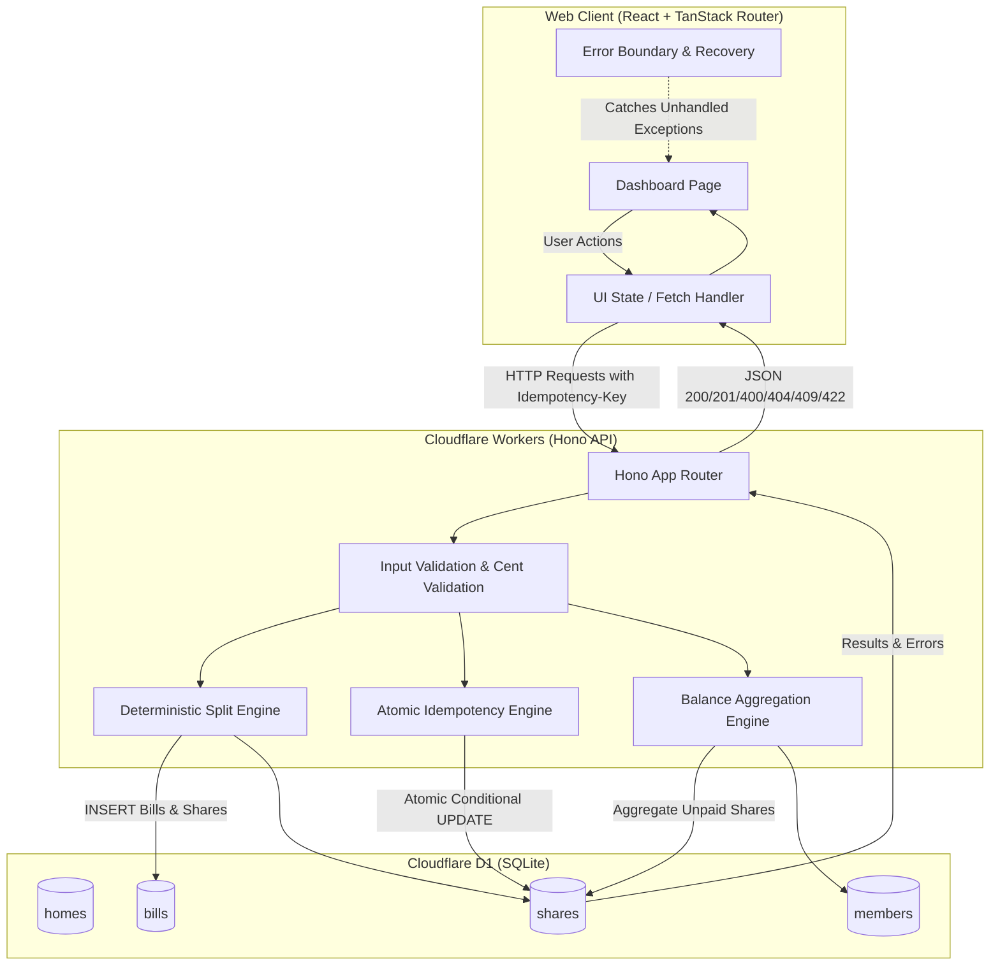

## Architecture and Data Flow



---

## Project Compromises & Trade-Offs

Per the prompt specification, here is an explicit analysis of features and technical choices compromised in favor of correctness, safety, and simplicity:

| Feature / Architecture Area      | What We Compromised (Omitted / Simplified)                                                                                    | What We Prioritized Instead                                                                                                   | Justification & Rationale                                                                                                                                                                                                                                                                                    |
| :------------------------------- | :---------------------------------------------------------------------------------------------------------------------------- | :---------------------------------------------------------------------------------------------------------------------------- | :----------------------------------------------------------------------------------------------------------------------------------------------------------------------------------------------------------------------------------------------------------------------------------------------------------- |
| **Idempotency Architecture**     | Separate Redis / KV distributed cache or complex two-phase commit log.                                                        | In-row atomic SQL state (`paid_at` + `idempotency_key` on `shares` table with `UNIQUE` constraint).                           | Eliminates distributed cache invalidation bugs and network partition risks. Cloudflare D1 guarantees ACID transactions; atomic `UPDATE ... WHERE paid_at IS NULL` guarantees zero duplicate payments even under concurrent race conditions.                                                                  |
| **Financial Representation**     | Arbitrary precision floating-point libraries (e.g. `bignumber.js` or `decimal.js`).                                           | Strict integer arithmetic in whole **cents** (`totalCents`, `amountCents`).                                                   | Eliminates IEEE 754 binary floating-point inaccuracy (`0.1 + 0.2 !== 0.3`). Makes division remainders trivially exact through integer arithmetic (`Math.floor` + modulo remainder distribution).                                                                                                             |
| **Member Ordering**              | Relying purely on microsecond wall-clock timestamps (`created_at`).                                                           | Explicit sequential order index (`created_order INTEGER`).                                                                    | Cloudflare Workers / SQLite timestamps can collide in sub-millisecond automated tests or batch inserts. An explicit sequence number ensures 100% deterministic, immutable ordering for remainder cent distribution.                                                                                          |
| **Frontend State Management**    | External heavy global state libraries (Redux, Zustand, React Query cache invalidation trees).                                 | Focused custom hook with native React state, optimistic lock avoidance, and explicit fetch error boundaries.                  | Zero bundle bloat, zero SSR hydration mismatches, and complete control over loading, empty, and failure states. Keeps code clean and immediately understandable for technical review.                                                                                                                        |
| **UI Payment Feedback Strategy** | Optimistic UI updates (immediately marking share as paid before API confirmation).                                            | **Pessimistic UI updates** with inline button loading spinners and explicit error banners.                                    | In shared bill splitting, roommate payment collisions (two members paying the same share concurrently) are a primary edge case. Optimistic updates would falsely tell a roommate their payment succeeded, only to revert it later. Pessimistic updates ensure data truth is verified before updating the UI. |
| **Feature Scope**                | Authentication, multi-currency conversion, debt simplification graphs (Splitwise-style graph reduction), receipt attachments. | Laser-focused core bill splitting, rigorous concurrency safety, clean TypeScript types, and comprehensive edge-case handling. | Follows assignment specification: _"The assignment is small on purpose. We want correct, safe, and clear code. We do not want many features."_                                                                                                                                                               |

---

## User Review Required

> [!IMPORTANT]
> **Environment Verification**: The active shell currently lacks `pnpm` and `node` in its standard PATH. Before automated test execution, Node.js and `pnpm` will need to be configured or loaded in the shell environment.
>
> **Project Directory**: The repository is located at `/Users/kuljeet/Projects/Task/sde-intern-task` (rather than `sde-intern-task-002`).

> [!NOTE]
> All visible tests in `api/test/` will be run and verified without any modifications to `api/test/` or `api/test/helpers.ts`, in strict compliance with the assignment rules.

---

## Open Questions

None currently blocking. The functional requirements and edge cases are clearly defined in the README and visible test specifications.

---

## Proposed Changes

### Component 1: Database Schema & Migrations (`api/migrations/`)

We will create `0001_init.sql` defining 4 relational tables with 9 named constraints.

#### [NEW] `api/migrations/0001_init.sql`

```sql
-- Migration 0001: Initial schema for shared bill splitter
PRAGMA foreign_keys = ON;

-- 1. Homes Table
CREATE TABLE IF NOT EXISTS homes (
  id TEXT PRIMARY KEY NOT NULL,
  name TEXT NOT NULL,
  created_at TEXT NOT NULL DEFAULT (strftime('%Y-%m-%dT%H:%M:%fZ', 'now')),
  CONSTRAINT ck_homes_name_nonempty CHECK (length(trim(name)) > 0)
);

-- 2. Members Table
CREATE TABLE IF NOT EXISTS members (
  id TEXT PRIMARY KEY NOT NULL,
  home_id TEXT NOT NULL,
  name TEXT NOT NULL,
  created_order INTEGER NOT NULL,
  created_at TEXT NOT NULL DEFAULT (strftime('%Y-%m-%dT%H:%M:%fZ', 'now')),
  CONSTRAINT fk_members_home FOREIGN KEY (home_id) REFERENCES homes(id) ON DELETE CASCADE,
  CONSTRAINT ck_members_name_nonempty CHECK (length(trim(name)) > 0)
);

CREATE INDEX IF NOT EXISTS idx_members_home_order ON members(home_id, created_order);

-- 3. Bills Table
CREATE TABLE IF NOT EXISTS bills (
  id TEXT PRIMARY KEY NOT NULL,
  home_id TEXT NOT NULL,
  title TEXT NOT NULL,
  total_cents INTEGER NOT NULL,
  created_at TEXT NOT NULL DEFAULT (strftime('%Y-%m-%dT%H:%M:%fZ', 'now')),
  CONSTRAINT fk_bills_home FOREIGN KEY (home_id) REFERENCES homes(id) ON DELETE CASCADE,
  CONSTRAINT ck_bills_total_positive CHECK (total_cents > 0),
  CONSTRAINT ck_bills_title_nonempty CHECK (length(trim(title)) > 0)
);

CREATE INDEX IF NOT EXISTS idx_bills_home ON bills(home_id);

-- 4. Shares Table
CREATE TABLE IF NOT EXISTS shares (
  id TEXT PRIMARY KEY NOT NULL,
  bill_id TEXT NOT NULL,
  member_id TEXT NOT NULL,
  amount_cents INTEGER NOT NULL,
  paid_at TEXT,
  idempotency_key TEXT,
  CONSTRAINT fk_shares_bill FOREIGN KEY (bill_id) REFERENCES bills(id) ON DELETE CASCADE,
  CONSTRAINT fk_shares_member FOREIGN KEY (member_id) REFERENCES members(id) ON DELETE CASCADE,
  CONSTRAINT ck_shares_amount_positive CHECK (amount_cents > 0),
  CONSTRAINT uq_shares_idempotency_key UNIQUE (idempotency_key)
);

CREATE INDEX IF NOT EXISTS idx_shares_bill ON shares(bill_id);
CREATE INDEX IF NOT EXISTS idx_shares_member_paid ON shares(member_id, paid_at);
```

#### Explanation of Named Constraints:

1. `fk_members_home`: Prevents orphaned member records referencing non-existent homes.
2. `ck_members_name_nonempty`: Prevents creating members with blank or whitespace-only names.
3. `fk_bills_home`: Prevents creating bills for non-existent homes.
4. `ck_bills_total_positive`: Enforces at database level that bill totals must be strictly positive whole cents (> 0).
5. `ck_bills_title_nonempty`: Prevents empty bill titles.
6. `fk_shares_bill`: Ensures every share belongs to an existing valid bill.
7. `fk_shares_member`: Ensures every share is assigned to a legitimate member.
8. `ck_shares_amount_positive`: Enforces that member share amounts must be strictly greater than 0.
9. `uq_shares_idempotency_key`: Ensures an idempotency key cannot be accidentally reused across distinct payments.

---

### Component 2: API Application & Route Handlers (`api/src/`)

We will implement clean, modular, and strictly typed handlers in `api/src/index.ts` (or separated into route modules):

#### [MODIFY] `api/src/index.ts`

Key Route Handlers:

1. **`POST /api/homes`**
   - Body validation: `name` must be a string and `name.trim().length > 0`.
   - Generates UUID `id = crypto.randomUUID()`.
   - Inserts into `homes`.
   - Returns `201` `{ id, name }`.

2. **`POST /api/homes/:homeId/members`**
   - Validates home exists: `SELECT id FROM homes WHERE id = ?`. If missing -> `404` `{ error: "Home not found" }`.
   - Validates `name` is non-empty.
   - Calculates next `created_order`: `SELECT COALESCE(MAX(created_order), 0) + 1 AS next_order FROM members WHERE home_id = ?`.
   - Generates UUID `id = crypto.randomUUID()`.
   - Inserts member into `members`.
   - Returns `201` `{ id, homeId, name }`.

3. **`POST /api/homes/:homeId/bills`**
   - Validates `totalCents`:
     ```ts
     if (
       typeof totalCents !== "number" ||
       !Number.isInteger(totalCents) ||
       totalCents <= 0
     ) {
       return c.json({ error: "totalCents must be a positive integer" }, 422);
     }
     ```
   - Validates home exists: `SELECT id FROM homes WHERE id = ?`. If missing -> `404` `{ error: "Home not found" }`.
   - Queries members in insertion order:
     ```sql
     SELECT id, name FROM members WHERE home_id = ? ORDER BY created_order ASC
     ```
   - If members list is empty -> `422` `{ error: "Home has no members" }`.
   - **Deterministic Remainder Splitting**:

     ```ts
     const n = members.length;
     const base = Math.floor(totalCents / n);
     const remainder = totalCents % n;

     const shares = members.map((member, index) => ({
       id: crypto.randomUUID(),
       memberId: member.id,
       amountCents: base + (index < remainder ? 1 : 0),
       paidAt: null,
     }));
     ```

   - Persists bill and shares using D1 batch transaction: `env.DB.batch([...])`.
   - Returns `201` `{ id, homeId, title, totalCents, shares }`.

4. **`POST /api/bills/:billId/shares/:shareId/pay`**
   - Header check: `c.req.header('Idempotency-Key')`.
     If missing or empty -> `400` `{ error: "Idempotency-Key header is required" }`.
   - Verify bill exists: `SELECT id FROM bills WHERE id = ?`. If not found -> `404` `{ error: "Bill not found" }`.
   - Verify share exists: `SELECT * FROM shares WHERE id = ? AND bill_id = ?`. If not found -> `404` `{ error: "Share not found" }`.
   - **Idempotency & Concurrency Evaluation**:
     - If share is already paid (`paid_at !== null`):
       - If `share.idempotency_key === key`: return `200` `{ id: share.id, memberId: share.member_id, amountCents: share.amount_cents, paidAt: share.paid_at }`.
       - If `share.idempotency_key !== key`: return `409` `{ error: "Share already paid with a different idempotency key" }`.
     - If share is unpaid (`paid_at IS NULL`):
       - Attempt atomic update:
         ```sql
         UPDATE shares
         SET paid_at = ?, idempotency_key = ?
         WHERE id = ? AND bill_id = ? AND paid_at IS NULL
         ```
       - If `meta.changes === 1`:
         Return `200` with the updated share details and timestamp.
       - If `meta.changes === 0` (concurrent request raced and updated it first):
         Re-query share. If paid with identical key return `200`, otherwise return `409`.

5. **`GET /api/homes/:homeId/balances`**
   - Validates home exists: `SELECT id FROM homes WHERE id = ?`. If not found -> `404` `{ error: "Home not found" }`.
   - Aggregates balances across all bills in member insertion order:
     ```sql
     SELECT
       m.id AS memberId,
       m.name AS name,
       COALESCE(SUM(s.amount_cents), 0) AS outstandingCents
     FROM members m
     LEFT JOIN shares s ON s.member_id = m.id AND s.paid_at IS NULL
     WHERE m.home_id = ?
     GROUP BY m.id, m.name, m.created_order
     ORDER BY m.created_order ASC
     ```
   - Returns `200` `{ balances: [...] }`.

6. **Web Supporting Endpoints** (for frontend display):
   - `GET /api/homes`: List homes.
   - `GET /api/homes/:homeId/bills`: Return all bills of a home with nested shares and member names.

---

### Component 3: Web Application (`web/src/routes/`)

We will build an interactive, responsive, and crash-resilient single-page application in `web/src/routes/index.tsx`.

#### [MODIFY] `web/src/routes/index.tsx`

Features to implement:

1. **Home Selection & Creation**:
   - Allows creating a home or switching between homes.
   - Shows empty states if no homes exist.
2. **Member Management**:
   - Displays members in creation order.
   - Inline form to add members.
3. **Bill Creation Form**:
   - Form for title and total amount (allowing dollars input formatted to cents).
   - Validates positive amounts; disabled if home has 0 members with informative warning.
4. **Bills and Shares Listing**:
   - Lists each bill with title, total amount, and creation date.
   - Displays each member's share with amount and status tag (`PAID` at timestamp vs `UNPAID`).
   - "Pay" button per unpaid share:
     - Automatically generates a unique `Idempotency-Key` (using `crypto.randomUUID()`).
     - Shows inline loading indicator while payment is in-flight.
     - On failure: keeps share unpaid and displays server error message.
5. **Outstanding Balances Summary Card**:
   - Live breakdown of `outstandingCents` for each member in order.
   - Automatically refreshes when a share is paid or a new bill is created.
6. **Resilience & State Handling**:
   - **Loading State**: Skeleton/spinner during initial fetch and mutations.
   - **Empty State**: Friendly messages when no bills or members exist yet.
   - **Error State**: Non-blocking toast/alert banners when network fails or API returns 500.
   - **Error Boundary**: React Error Boundary wrapper around root page preventing crashes if unexpected errors occur.

---

## Verification Plan

### Automated Tests

1. Run all visible tests:

   ```bash
   pnpm test
   ```

   Must pass:
   - `api/test/homes.test.ts` (home creation, member creation, 404s)
   - `api/test/bills.test.ts` (even split, remainder cent distribution, total sums, 1 member, 0 members 422, invalid cents 422, 404s)
   - `api/test/payments.test.ts` (pay share, missing idempotency key 400, repeat key 200, conflicting key 409, nonexistent share/bill 404, balances calculation across multiple bills)

2. Run Biome checks (linting and formatting):

   ```bash
   pnpm check
   ```

3. Run TypeScript type checks across all packages:

   ```bash
   pnpm typecheck
   ```

4. Run web build:
   ```bash
   pnpm build
   ```

### Manual Verification

1. Start dev servers: `pnpm dev`
2. Open `http://localhost:5173`:
   - Create a home ("Apartment 101").
   - Add 3 members ("Alice", "Bob", "Charlie").
   - Add a bill for $10.00 (1000 cents). Verify split shows $3.34 for Alice, $3.33 for Bob, $3.33 for Charlie.
   - Verify balances card shows $3.34, $3.33, $3.33.
   - Click "Pay" for Alice's share. Verify status changes to Paid and Alice's balance drops to $0.00.
   - Test error cases: simulate network failure / invalid input and verify web app shows user-friendly error banner and never crashes.
